 

 

- 🏆 **2nd place**, Decode to Code (PCCOE) &nbsp;·&nbsp; **3rd place**, Prompt-a-Thon (PCCOE)
- 📜 **JPMorgan Chase & Co.** Software Engineering Job Simulation &nbsp;·&nbsp; **HackerRank** Java, SQL, Problem Solving &nbsp;·&nbsp; **Cisco** Networking Basics
- 🏃 District-level **Kho-Kho** player, *Best Sport Person* & *Best Volunteer* in college

 

  

  

  

 

<table>
<tr>
<td width="50%" valign="top">

### 🗂️ LIFE OS
**Full stack productivity suite**

Habit tracker with streaks & heatmap, Kanban task engine, Pomodoro timer and expense analytics, all in one dashboard. **20+ REST APIs** with Spring Security, JWT & role-based access; Dockerised backend with CI/CD on every push.

`React` `Spring Boot` `Spring Security` `JWT` `Docker`

</td>
<td width="50%" valign="top">

### 🚕 AVIRO
**Affordable, Verified & Intelligent Ride Organizer**

College ride-sharing for Pune students with **AI college-ID verification (96% accuracy, Gemini Vision)**, real-time WebSocket chat, live GPS tracking, UPI payments and SOS alerts.

`Spring Boot` `React` `MySQL` `Redis` `WebSocket` `Docker`

</td>
</tr>
<tr>
<td width="50%" valign="top">

### 📄 Resume Enhancer
**AI career preparation platform**

ATS resume analyzer, AI resume builder, cover-letter generator, interview Q&A and a career-coach chatbot, powered by **Groq (Llama 3) + RAG**.

`Next.js` `Node.js` `Express.js` `MongoDB` `Groq AI` `Tailwind`

</td>
<td width="50%" valign="top">

### 🌐 Portfolio Website
**Hand-built personal site**

Responsive portfolio with a signature animated intro, scroll animations, light/dark theme and detailed project pages, built without any framework.

`HTML` `CSS` `JavaScript`

</td>
</tr>
</table>

 

<picture>
  <source media="(prefers-color-scheme: dark)" srcset="https://raw.githubusercontent.com/sahilshaikh450/sahilshaikh450/output/snake-dark.svg" />
  <source media="(prefers-color-scheme: light)" srcset="https://raw.githubusercontent.com/sahilshaikh450/sahilshaikh450/output/snake-light.svg" />
  
</picture>

 

**Open to full-time Software Engineer roles, internships & freelance work.**
 
Fastest way to reach me: **[sahilshaikh34088@gmail.com](mailto:sahilshaikh34088@gmail.com)**

 

